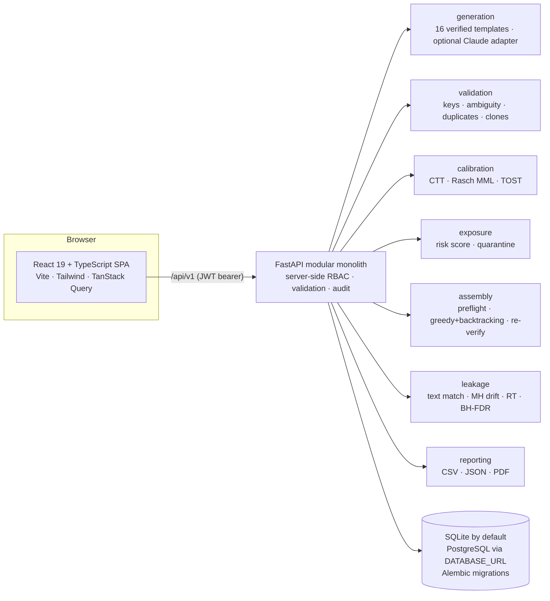

# AptiGuard AI — IM-107 “An aptitude test that survives ten slots”

Assessment-integrity prototype: verifiable parallel-item generation → mandatory human review → calibration →
exposure-aware multi-slot assembly → assigned, server-scored delivery → evidence-backed leak detection.

> **All data in this repository is synthetic** (deterministic seed 107). The official Integraminds datasets were not
> available. Every result quoted below describes the synthetic scenario only and is **not** real-world validation.

## Architecture



Full design notes: [docs/architecture.md](docs/architecture.md).

## Quick start (local, offline)

Requirements: Python 3.11+ (3.12 tested), Node 20+ (Node 26 tested). No cloud services or API keys.

```bash
./setup.sh
```

```bash
./start.sh
```

- Web app: http://localhost:5173 · API docs (OpenAPI): http://127.0.0.1:8000/api/docs
- `setup.sh` creates `backend/.venv`, installs npm packages, runs Alembic migrations and seeds the synthetic demo.
- Reset the demo database at any time (wipes and recreates **synthetic** demo data only; refuses when
  `DEMO_MODE=false` or `APP_ENV=production`):

```bash
backend/.venv/bin/python scripts/seed_demo.py
```

Docker alternative (written, **not verified here** because Docker was unavailable on the build machine):
`docker compose up --build`, then open http://localhost:8080.

## Demo accounts (synthetic, local demo mode only)

With `DEMO_MODE=true` (default outside production) the login page offers one-click sign-in for each role.
All demo accounts share the password from `DEMO_PASSWORD` (default `AptiGuard-Demo-2026`). Production configuration
refuses to start with demo mode on, and the demo credentials are never served when demo mode is off.

| Account | Role | Can |
|---|---|---|
| admin@aptiguard.demo | Administrator | everything incl. policies, audit log, demo reset |
| designer@aptiguard.demo | Assessment Designer | author items, generate variants, assemble, publish, assign candidates |
| reviewer@aptiguard.demo, reviewer2@… | Reviewer | approve/reject/regenerate (not own items), quarantine/release, investigate leaks |
| analyst@aptiguard.demo | Psychometric Analyst | calibration, data import, leak detection, audit log |
| candidate1/2/3@aptiguard.demo | Candidate | take **assigned** assessments only |

## 6-minute demonstration

1. **Login page** → *Sign in as Psychometric Analyst*. Dashboard: live KPIs, slot comparison (raw score vs Rasch θ ± CI), alerts, overlap.
2. **Leak Detection** → *Run detection*. Open the CRITICAL alert for `QNT-SDT-M1-S`: verbatim post evidence, Mantel–Haenszel drift
   (baseline p → later p, ETS Δ, BH q-value), response-time drop, per-slot curve, affected family, first detectable slot.
   Compare the *statistical-only* alert (`LOG-ORDER-H1-S`), labelled differently because no text exists.
3. Sign out → **Reviewer**: add a note → *Confirm leak & quarantine*. Any draft/published form containing the item is flagged *needs reassessment*.
4. **Designer** → **AI Variant Studio**: pick a source, generate variants; see recomputed answers and rejected candidates with reasons.
5. **Reviewer Workspace** (reviewer): compare source/variant, approve. Designers get 403; authors cannot approve their own items (409).
6. **Calibration Lab**: n, p with Wilson CI, item–rest r, Rasch b ± SE, Δ vs source with 90% CI, TOST decision, sample-size warnings; export CSV/PDF.
7. **Test Assembler** (designer): generate 10 slots at a 10% adjacent-overlap limit → verified overlap matrix; set *Max slot exposures* = 1 → explicit infeasibility with the bottleneck. Publish, then assign `DEMO-CAND-03`.
8. **Candidate**: only assigned forms are listed; answer (A–D keys), submit, server-calculated score. Answer keys never reach the browser.

## Tests and checks

```bash
cd backend && .venv/bin/python -m pytest -q
```

```bash
cd frontend && npm test && npm run typecheck && npm run build
```

```bash
cd frontend && npx playwright install chromium && npx playwright test
```

```bash
backend/.venv/bin/python scripts/run_validation.py
```

Results of the latest run are in [docs/test-report.md](docs/test-report.md). The Playwright suite starts its own
backend (port 8001) on a throw-away seeded database and never touches `backend/var/aptiguard.db`.

## Configuration

See [.env.example](.env.example). Key variables: `APP_ENV`, `DATABASE_URL`, `JWT_SECRET`, `CORS_ORIGINS`, `DEMO_MODE`,
`DEMO_PASSWORD`, `LOGIN_MAX_FAILURES`, `MAX_UPLOAD_MB`, `LLM_PROVIDER`/`LLM_API_KEY`/`LLM_MODEL` (optional).
With `APP_ENV=production` the API refuses to start unless `DEMO_MODE=false`, `JWT_SECRET` is ≥ 32 random characters
and `CORS_ORIGINS` lists explicit origins.

## Data: synthetic vs real

- `data/synthetic/` is generated by `scripts/seed_demo.py` (deterministic; `MANIFEST.json` holds SHA-256 hashes).
- `leak_ground_truth.json` documents exactly which items were deliberately leaked and how; the detector never reads it.
- Real data can be imported through the UI/API (`/calibration/import`, `/leaks/datasets`) using the documented CSV/JSON/JSONL schemas.

## Security, limitations and AI disclosure

- Security model and remaining risks: [docs/security-review.md](docs/security-review.md)
- Honest list of limitations: [docs/known-limitations.md](docs/known-limitations.md)
- **AI assistance:** this prototype was designed and implemented with substantial assistance from an AI coding assistant
  (Anthropic Claude via Claude Code), directed and reviewed by the team. All metrics in this repository come from
  executed tests and scripts on synthetic data; none are estimated or invented.
