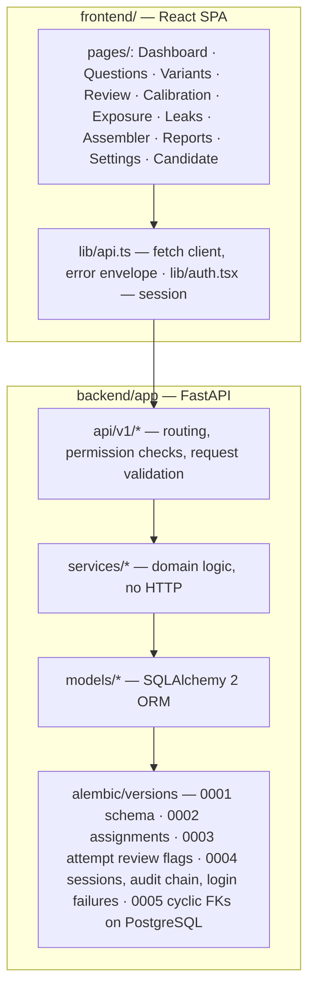

# Architecture

## Components



## Key flows

```mermaid
sequenceDiagram
  participant D as Designer
  participant R as Reviewer
  participant A as Analyst
  participant C as Candidate
  participant API
  D->>API: generate variants (template / optional LLM)
  API-->>API: validate (recompute key, ambiguity, duplicates, clones)
  API-->>R: pending_review queue (never auto-published)
  R->>API: approve (re-validated; author ≠ approver)
  D->>API: assemble slots (preflight → greedy+backtracking → independent verification)
  D->>API: publish (eligibility re-checked) + assign candidates
  C->>API: start (assigned + published + window) → save → submit (atomic, server-scored)
  A->>API: import leak dataset → detect (text, MH drift, RT, BH-FDR)
  R->>API: investigate → confirm (item quarantined, forms flagged needs_review)
  Note over API: live attempts continue; staff-only review flag + alternative score; audit event
  R->>API: resolve flagged attempt (retain / alternative / reassessment, reason required; history kept)
```

## Data model highlights

- `questions` ↔ `variant_families` (source + variants), `answer_options`, `validation_results`, `question_revisions`, `review_decisions`.
- `slots` → `test_forms` → `form_items`; `candidate_assignments` (unique candidate×form); `attempts` (unique candidate×form) → `responses` (unique attempt×question).
- `exposure_events` (unique form×question×type), `calibration_runs` → `item_calibrations`, `leak_datasets` → `leak_records`, `leak_detection_runs` → `leak_alerts` → `investigations` → `investigation_events`, `audit_events`, `policies`.
- All domain tables are organisation-scoped directly or through their parent; routers check the caller's organisation.

## Statistical methods (short)

- **CTT**: p with Wilson score CI; omissions tracked separately; corrected item–rest correlation.
- **Rasch (1PL)**: marginal ML via EM (Bock–Aitkin), N(0,1) ability prior; refused for disconnected designs;
  suspected/confirmed leaked items excluded from linking.
- **Variant equivalence**: TOST via the 90% CI of the difficulty difference (Rasch logits; Newcombe score interval for
  the preliminary p-scale) — inconclusive results are reported as *requires review*, never as equivalent.
- **Leak drift**: Mantel–Haenszel across rest-score strata (purified), ETS Δ effect size, Benjamini–Hochberg FDR;
  response-time ratio normalised by slot pace with a one-sided Mann–Whitney test; slot-by-slot replay for the earliest detectable slot.
